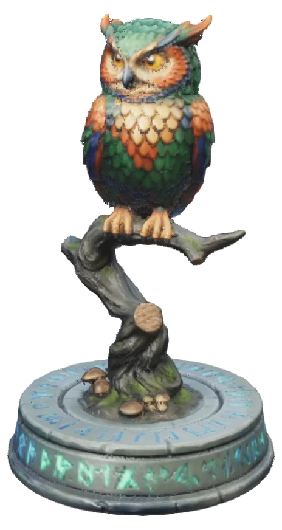

# Image 3D

Display an interactive 3D capture with a regular HTML image and one JavaScript file. The browser runtime has no dependencies and uses WebGPU or WebGL 2.

## Quick start: use an ``

Place `img-3d.js` and your capture on your website, then add `data-img-3d` to the image:

```html
<script type="module" src="./img-3d.js"></script>

```

The WebP contains both a normal image and the 3D capture. The browser displays the image first; the script adds drag-to-rotate interaction when the capture is ready. Without JavaScript, the image still displays normally. Printing also uses the image.

Use a WebP packaged for Image 3D, such as the included [owl capture](demo/public/owl-512-i3d/live.webp), or [create a capture](#create-a-capture). Regular image resizing and re-encoding can remove the embedded 3D data, so serve the packaged file unchanged.

## Size it like an image

Use the usual image attributes and CSS. `width` and `height` reserve space while the image loads; `max-width` and `height: auto` make it fit smaller screens.

```html

```

Set `width` and `height` to the actual dimensions of your WebP. No special layout CSS is required for the 3D view. The runtime keeps it aligned with the image.

Native `srcset`, `sizes` and `<picture>` work too. For example, using the two included owl captures:

```html

```

The browser chooses the file, and the 3D view uses that same file. The `w` values are the WebPs' actual pixel widths; the packaging tool prints them for you.

To enhance a whole `<picture>`, put `data-img-3d` on the `<picture>` instead of its ``.

## Auto-rotate a capture

Add `auto-rotate` to `` for a slow rotation, or set a signed speed
in radians per second. The default is 0.3 rad/s. A negative speed reverses
direction. Use `data-auto-rotate` on an enhanced native image or picture.

```html
</img-3d>

```

Rotation waits for the capture, pauses while hidden, and stops when the
viewer is used. Reduced-motion preferences disable it.

## Control the view with JavaScript

You can also enhance an image already on the page:

```html


<script type="module">
  import {enhanceImage} from './img-3d.js';

  const preview = enhanceImage(document.querySelector('#product'));
  preview.element.yaw = 0.8;
  preview.element.pitch = 0.2;
  await preview.element.draw();
</script>
```

`yaw` and `pitch` are in radians. `distance` controls zoom. Call `draw()` after changing these settings. Call `preview.disconnect()` to restore the plain image. The same API is available when the image was enhanced automatically with `data-img-3d`.

## Use the `` element

For a dedicated 3D element, use `` with a `.i3d` capture or a packaged WebP. Load the same `img-3d.js` script as above.

```html
<style>
  img-3d {
    display: block;
    width: 300px;
    height: 300px;
  }
</style>

</img-3d>
```

The CSS gives the custom element a size before JavaScript loads, so the page doesn't shift when it appears. This is only needed for the custom element; a regular `` already has native image sizing.

Both forms support `object-fit` and `object-position`. Framing stays fixed while rotating by default. Add `data-orbit-fit="auto"` to let the frame expand for wider viewing angles.

Drag or use the arrow keys to rotate, use `+`, `-` or Alt+wheel to zoom, and double-click or press Home to reset. Vertical touch gestures allow page scrolling.

See the [runtime API and capture format](https://github.com/needle-tools/image-3d/blob/main/docs/format.md) for responsive `.i3d` sources and other options.

## Use studio lighting

Choose one of these ways to enable studio lighting on a live capture.

For a regular WebP image enhanced by the runtime, use `data-environment`:

```html

```

If you're using the `` element, use `environment` instead:

```html
</img-3d>
```

The viewer fetches and shares the roughly 35 kB map only when a preview requests it. For a self-hosted runtime, place `studio.json.gz` next to `img-3d.js`. With jsDelivr, the viewer loads the map from the same npm package version automatically.

```html
<script type="module" src="https://cdn.jsdelivr.net/npm/@needle-tools/image-3d@0.1.2/dist/img-3d.js"></script>
```

For custom integrations, the npm asset resolves at `@needle-tools/image-3d/env/studio`. For example, Vite can import its URL with `@needle-tools/image-3d/env/studio?url`. [Environment lighting API](https://github.com/needle-tools/image-3d/blob/main/docs/format.md)

## Create a capture

Create and host Image 3D captures with [Needle Cloud](https://cloud.needle.tools).
Upload your 3D asset, generate an Image3D variant, and use its WebP URL in your
`` element. Cloud handles capture generation and hosting.

### Local conversion

The following commands run from a checkout of this repository with its development
dependencies installed.

The converter takes a GLB containing [`NEEDLE_box_impostor`](https://needle.click/mesh-baker) capture data, with uncompressed PNG capture maps. Animated inputs must be frozen first. It does not convert an ordinary mesh or photograph into a 3D capture.

```sh
npm run convert -- capture.glb output --webp
```

This writes `output/model.i3d` and `output/model.webp`, and prints the image dimensions. WebP poster generation requires Chrome. You can also package an existing `.i3d` file:

```sh
node tools/package-image.mjs capture.i3d model.webp
```

Add `--poster image.webp` to provide your own poster. Its camera view, framing and dimensions should match the capture. To check the converted capture:

```sh
npm run validate -- output --dense
```

## Try the demo

After installing dependencies, start the demo:

```sh
npm run dev
```

Open the printed URL to rotate the included models and try different lighting and resolutions. Copy the URL to share the selected settings and camera.

## Development and reference

Run `npm test` for the automated checks. Browser tests require Chrome and run sequentially.

- [Runtime API and capture format](docs/format.md)
- [Rendering measurements](docs/measurements.md)
- [Third-party licenses and notices](LICENSES/README.md)

## Optional: XUASTC compression

Captures encoded with XUASTC can use compressed GPU textures. For these files, load `img-3d-xuastc.js` instead of `img-3d.js`:

```html
<script type="module" src="./img-3d-xuastc.js"></script>

```

The XUASTC entry includes the decoder and WebAssembly in one JavaScript file. The HTML and camera API stay the same.

To encode an existing conversion, install the Basis Universal encoder and pass its executable to the compression tool:

```sh
node tools/xuastc.mjs output compressed-output /path/to/basisu
npm run validate -- compressed-output --dense
```

To package an XUASTC capture as WebP, use `node tools/package-image.mjs capture.i3d model-xuastc.webp --xuastc`.

## Technical note: how the WebP file loads

An Image 3D WebP is a regular WebP image. Its image data comes first, allowing the browser to decode and display it while the rest of the file is still downloading. This follows the [WebP container specification's ordering for streaming image data](https://developers.google.com/speed/webp/docs/riff_container#extended_file_format).

The 3D capture is embedded sidecar data in an `I3D1` RIFF chunk after the image, inside the same `.webp` file. The [WebP specification allows application-specific chunks](https://developers.google.com/speed/webp/docs/riff_container#unknown_chunks), which ordinary image readers can ignore. Image 3D reads this extra data to render the interactive view. See the [Image 3D WebP package format](docs/format.md#webp-image-package) for its layout.

For programmatic shared-camera scenes and opt-in progressive loading, see [scene loading](docs/scenes.md).

## Contact

Questions or feedback? Email [hi@needle.tools](mailto:hi@needle.tools).

[Needle](https://needle.tools) | [GitHub](https://github.com/needle-tools) | [Discord](https://discord.needle.tools) | [Forum](https://forum.needle.tools)
